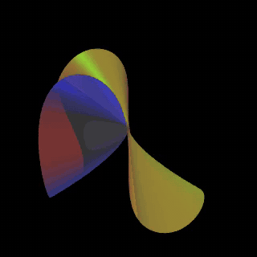

# resolution

Visual and auditory notes toward an honest animation of a surface singularity being resolved.

## Special thanks — David A. Madore

**Thank you to [David A. Madore](http://www.madore.org/cubic-dvd/)** for creating and openly sharing *The Cubic Surfaces DVD*: 54 mathematical animations of cubic surfaces and their singularities, with the original POV-Ray source code made public. His controlled lighting, clipping, and deformation films are an important visual reference for this project. Madore released that DVD and its accompanying source into the public domain and asked for recognition of his authorship; **we gladly give it**. His films show **deformations**, while the resolution maps and exceptional curves proposed here are a separate undertaking.

**[Full acknowledgment and source-code credit →](ACKNOWLEDGMENTS.md)** · **[Actual original POV-Ray and production code now copied here](vendor/david-madore/cubic-dvd/upstream/cubic-dvd/)** · [Original 2006 tarball](vendor/david-madore/cubic-dvd/original/cubic-dvd.tar.gz) · [Import manifest](vendor/david-madore/cubic-dvd/SOURCE-MANIFEST.json) · [Madore's source page](http://www.madore.org/cubic-dvd/) · [YouTube playlist](https://www.youtube.com/playlist?list=PL1AE045877D932E6A)

The first target is not merely a rotating implicit surface. It is a film that keeps four different objects straight:

1. the singular surface;
2. a real three-dimensional slice or projection of it;
3. the sequence of blowups or other birational modifications;
4. the exceptional curves and their intersection graph on the resolved surface.

## Actual E6 films — POV-Ray and SURFER

**Both films were rendered from the exact cubic** `x² + xz² + y³ = 0`, extracted from David A. Madore's original `03s01a.pov`. They use different camera and surface-clipping conventions. The short movies show a **real three-dimensional locus**, not a complex-surface resolution.



**[POV-Ray: 32-frame animated GIF](renders/madore-e6/madore-e6-povray.gif)** · [MP4](renders/madore-e6/madore-e6-povray.mp4) · [validation manifest](renders/madore-e6/madore-e6-povray-manifest.json) · [rendering script](scripts/render-madore-e6-povray.sh)

**[SURFER/jsurf: 32-frame animated GIF](https://github.com/isomorphismes/algebraic-variety-explorer-mobile/blob/surfer/renders/madore-e6/madore-e6-surfer.gif)** · [MP4](https://github.com/isomorphismes/algebraic-variety-explorer-mobile/blob/surfer/renders/madore-e6/madore-e6-surfer.mp4) · [SURFER pull request](https://github.com/isomorphismes/algebraic-variety-explorer-mobile/pull/29)

See [exact derivation and comparison](notes/09-madore-e6-cross-render.md) and [the complete source polynomial atlas for all 54 films](notes/10-madore-source-polynomial-atlas.md).

## First correction

A **deformation** or **smoothing** is not a **resolution**.

A smoothing changes the equation in a family, for example

```text
x² + y³ + z⁵ = 0
```

to

```text
x² + y³ + z⁵ = ε.
```

A resolution keeps the original singular surface as the target of a map

```text
Y → X
```

and replaces the singular point upstairs by an exceptional configuration of curves. David A. Madore's short cubic-surface films are valuable visual references, but their moving families are chiefly deformations, smoothings, rotations, and changes of coefficients. They do not by themselves show the birational resolution map.

The project should show both operations and label them.

## First comparison

The phrase “normal singularity” is ambiguous here. A Du Val singularity is already a **normal** surface singularity. The useful first three-way comparison is:

- `A₀`: a smooth point;
- `A₁`: the ordinary double point;
- `E₈`: the most complicated exceptional Du Val surface singularity.

A standard equation for `E₈` is

```text
x² + y³ + z⁵ = 0.
```

This is a complex surface: two complex dimensions, hence four real dimensions. No ordinary three-dimensional image can display it faithfully. Every 3D image must therefore declare what it is:

- the real locus in `R³`;
- a slice of the complex surface;
- a projection of a higher-dimensional object;
- its link;
- its Milnor fibre;
- or a schematic picture of the exceptional curves.

## What the resolved E₈ contains

The minimal resolution replaces the singular point by eight rational curves. Each curve is a copy of `P¹`, hence topologically a 2-sphere over the complex numbers. Each has self-intersection `−2`. Their pairwise intersections form the `E₈` Dynkin tree. The intersection matrix is the negative `E₈` Cartan matrix.

Rendering each exceptional `P¹` as a sphere is reasonable, but it must be labeled as a model of a complex curve. Those spheres are not literally sitting inside the original real locus in `R³`.

## Proposed first film

Use four synchronized panels:

1. **Local picture** — an implicit real slice or projection of the singular surface.
2. **Chart picture** — the active blowup chart, coordinate substitution, and residual equation.
3. **Exceptional fibre** — the rational curves introduced so far, rendered schematically as spheres meeting at points.
4. **Combinatorics** — the partial dual graph, self-intersections, and intersection matrix.

The viewer should be able to rotate panels 1 and 3. Panel 2 prevents the animation from becoming decorative fiction. Panel 4 shows what survives every choice of camera and projection.

Prototype in this order:

```text
A₁ → D₄ → E₈
```

`A₁` makes one exceptional curve visible. `D₄` introduces branching. `E₈` then presents the full eight-curve tree.

## Notes

- [`notes/01-mathematical-background.md`](notes/01-mathematical-background.md) — local algebra, normalization, blowups, Du Val equations, and exceptional curves.
- [`notes/02-rendering-storyboard.md`](notes/02-rendering-storyboard.md) — concrete guesses for a three-dimensional rendering and film sequence.
- [`notes/03-david-madore.md`](notes/03-david-madore.md) — notes on Madore's singularity films and Lie-theoretic sonification.
- [`notes/04-audio.md`](notes/04-audio.md) — three mathematically distinct audio systems.
- [`notes/05-complex-slice-atlas.md`](notes/05-complex-slice-atlas.md) — six real input channels, all twenty coordinate triples, `Re(f)=0`/`Im(f)=0`, Riemann-sphere chart boundaries, and the distinction between moving an input slice and moving an output probe.
- [`notes/06-david-madore-s3-polytopes.md`](notes/06-david-madore-s3-polytopes.md) — Madore's 120-cell/600-cell spherical navigation movies, gnomonic camera mathematics, original code, and the 120-cell/Poincaré sphere/`E₈`-link connection.
- [`notes/06-richard-borcherds-du-val.md`](notes/06-richard-borcherds-du-val.md) — Borcherds's E₈ lecture, reconstructed eight-point-blowup chart sequence, residual A₁/D₄ branches, and a distinct process tree for animation.
- [`notes/06-grassmannian-spectra.md`](notes/06-grassmannian-spectra.md) — Madore's *The sound of some grassmannians*, spectral reconstruction questions, and the distinction between three sonification methods.
- [`notes/07-madore-youtube-playlist.md`](notes/07-madore-youtube-playlist.md) — complete 20-video *Miscellaneous mathematical* playlist index, with links and specific analysis of `E8` projections, slices, Fourier data, homotopies and wave films.
- [`notes/07-e8-voronoi-slices.md`](notes/07-e8-voronoi-slices.md) — Madore's eight-dimensional E₈ Voronoi tessellation shown as moving 2D slices; exact nearest-lattice reconstruction, weighted planar sections, and the limited ADE connection.
- [`notes/07-david-madore-youtube-channel-map.md`](notes/07-david-madore-youtube-channel-map.md) — thematic map of Madore's mathematical video channel, including singularities, Lie-theoretic sound, E₈ and Weyl-group imagery, waves, four-polytopes, hyperbolic geometry, relativity, and Fourier experiments.
- [`notes/08-cubic-surfaces-youtube-playlist.md`](notes/08-cubic-surfaces-youtube-playlist.md) — exact 32-video inventory of Madore's *Cubic surfaces* YouTube playlist, linked to his 54-film DVD, with deformation-versus-resolution cautions.
- [`notes/09-madore-e6-cross-render.md`](notes/09-madore-e6-cross-render.md) — tested POV-Ray and SURFER/jsurf films of Madore's exact E₆ cubic, with mathematical and rendering differences recorded.
- [`notes/10-madore-source-polynomial-atlas.md`](notes/10-madore-source-polynomial-atlas.md) — original-source coefficients and rotation/clock controls for all 54 cubic-surface movies, plus a machine-readable JSON ledger.
- [`sources/README.md`](sources/README.md) — source ledger and links into the other repositories.
- [`papers/README.md`](papers/README.md) — Patrick du Val's original three-part paper and modern guides.

## Source policy

These notes adapt and cross-link earlier notes rather than copying books or papers at length. Immediate sources include:

- David Eisenbud, *Commutative Algebra with a View Toward Algebraic Geometry*;
- Miles Reid, *Chapters on Algebraic Surfaces* and *The Du Val Singularities Aₙ, Dₙ, E₆, E₇, E₈*;
- Patrick du Val's 1934 trilogy on isolated surface singularities that do not affect adjunction;
- David A. Madore's cubic-surface animations and Lie-group sound experiments;
- Richard E. Borcherds's lecture 39 on an explicit resolution of the E₈ singularity.

Credit belongs to the original authors and to the older work they cite, especially Patrick du Val, Michael Artin, Henry Laufer, Friedrich Hirzebruch, Heinrich Jung, John McKay, Bertram Kostant, Hermann Weyl, and the many people behind the ADE correspondence.